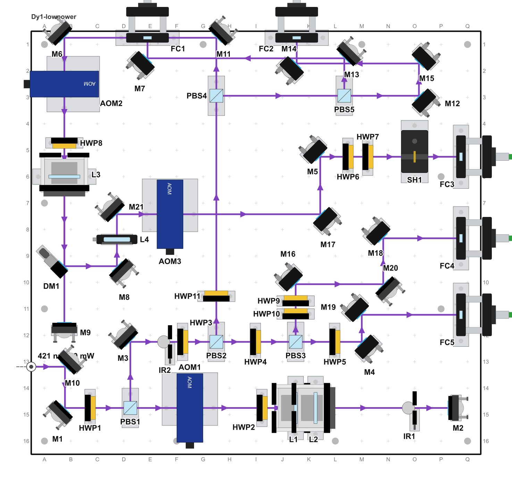
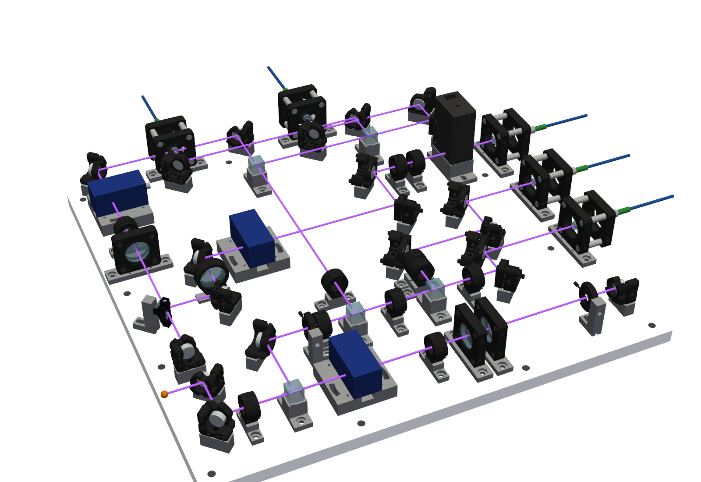
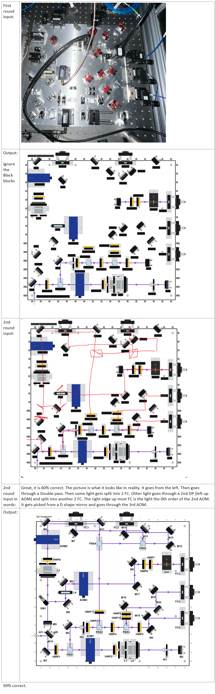

# Optical Layout Designer

Design an optical table or breadboard layout, see it in 3D, order the parts and keep a power log of the finished system.

It works like KiCad's schematic and board editors. You describe the optical system on a schematic, arrange the same parts true to scale on the board, and the two stay linked.





## Get started

It's developed and tested on Windows with Python 3.13.

```
pip install -r requirements.txt
python run.py examples/demo_schematic.json
```

`demo_schematic` is a small system, which makes it a good first file to explore. Run `python run.py` with no file to start a blank layout. To look at bigger boards, open these:

```
python run.py examples/demo_399nm.json             # a distribution board, with a sample power log
python run.py 421nm_system/Dy1-lowpower.json       # the board in the pictures above
```

A layout with power points but no log file asks you what to do when it opens. Choose **Open without log** if you're only looking around.

## Example: from a photo to a layout

Already have a board on the table? The `photo-to-layout` skill for [Claude Code](https://claude.com/claude-code) turns a top-down photo of it into a layout you can edit. The board at the top of this page was made this way, in two rounds. A photo shows the mounts but not the light, so Claude places the parts first and you then show it where the beams go.

To try it, copy `skills/photo-to-layout` into `.claude/skills`, then give Claude Code your photo.

**Round 1: the photo.** Claude works out the board type and size, corrects the camera's perspective, identifies each part and places it on the board. On this 421 nm LightFlow board, the parts came out mostly right, but the beam routing was only about 60 % right. Its first attempt missed both double passes.

**Round 2: your sketch and a few words.** Draw the real beams in red over the round 1 picture and describe what the light does. For this board, the description was:

> It goes from the left. Then goes through a Double pass. Then some light gets split into 2 FC. Other light goes through a 2nd DP (left up AOM) and split into another 2 FC. The right edge up most FC is the light the 0th order of the 2nd AOM. It gets picked from a D shape mirror and goes through the 3rd AOM.

Claude moves the turning mirrors onto your lines and links every beam. This board came out about 99 % right, and it's ready to open:

```
python run.py 421nm_system/Dy1-lowpower.json
```

The result is an ordinary layout, so you can fix what's left by hand, see it in 3D, list its parts and log power on it. Claude also writes a script, [examples/make_dy1_lowpower.py](examples/make_dy1_lowpower.py), that records how the layout was derived and can rebuild it.

Here is the whole process for this board: the photo, round 1, the red sketch, the description and the final layout. Ignore the black blocks in the middle pictures, which are label placeholders rather than parts.



## Design a board, start to finish

### 1. Set up the board
Press Ctrl+N for a new layout, then open **File > Board size, holes and shape…**. Set the size and choose the board type, which decides how parts are held and how high the beam sits:

| Board type | How parts are mounted | Beam height |
|---|---|---|
| 1" grid (classic breadboard) | On posts in a 1" grid of 1/4-20 holes | Your choice, 2" by default |
| Olego | On a pillar made for each mount, in 4-40 holes | 2" |
| PyOpticL | Screwed to a plate, on printed adapters or in pockets | 1/2" |
| LightFlow | Screwed to a plate, on machined pedestals | 1" |
| Pre-drilled | On posts, in holes drilled where each part stands | Your choice |

### 2. Draw the system in the schematic
The **Schematic** tab (Ctrl+1) defines what's in your system. Positions here don't matter, so think of it as a circuit diagram.

1. Click a symbol on the left, then click on the sheet to place it. Labels such as M1, L1 and PBS1 fill in by themselves.
2. Press B and click the parts in the order the light reaches them. Clicks chain together, and Esc stops. The colour comes from **New beams**.
3. To add a part to a beam you've already drawn, click **on the beam** when you place it.
4. Select a part to set its type and part number. Press Ctrl+T to edit every part in one spreadsheet.

### 3. Arrange it on the board
The **Layout** tab (Ctrl+2) is the true-to-scale board, and it follows the schematic live. Here you only move and rotate parts.

- Drag parts into place. They snap to the holes, and Alt-drag skips the snapping.
- Mirrors aim themselves to bisect their beams. Lenses, waveplates and irises line up with the beam, and cubes square up to it. You rarely need to rotate anything by hand.
- If you do, press R or Shift+R for ±45°, or [ and ] for ±5°. Press A to go back to automatic aiming.
- Parts that overlap get a red dashed outline. **Layout > Show overlapping parts** selects them.
- Press L to measure a distance, and Ctrl+L to show beam lengths.

Parts you add later wait in a strip below the board until you drag them in. **Layout > Arrange like the schematic** copies the schematic's arrangement again.

Double-click a part to jump to it in the schematic. Whatever you select on one tab is selected on the other too, and Ctrl+Tab switches between them.

### 4. Check it in 3D
The **3D** tab (Ctrl+3) builds the board with real mount shapes, posts or pedestals, and beams at the right height. Drag to rotate, use the wheel to zoom and Shift+drag to pan.

It needs no extra setup, because the meshes come with this repository. The tab is optional, and the app also runs without `pyvista` installed.

### 5. Order the parts and share the design
- **Bill of materials** (Ctrl+Shift+B): lists the parts, posts and adapters the board needs. Export it from the File menu as a CSV.
- **Pictures** (Ctrl+E for SVG, Ctrl+Shift+E for PNG): export the current tab.
- **File**: Ctrl+S saves both tabs in one plain JSON file.

## Keep a power log in the lab

Once the board is built, the same file becomes its logbook.

1. In the Layout tab, press M and click a beam to add a power point. Click a fiber coupler to measure after the fiber, which also gives you the coupling efficiency. Shift-click to add several points.
2. Click a point to log a reading. Enter the power, meter and notes, and the time is recorded for you. You can see the full history and a plot, and attach beam pictures from a file or the clipboard.
3. Each point on the board shows its latest power. The ring turns red or green if the last change was 10 % or more.

**Your history is safe.** Readings stay with the point even if you move parts, and a deleted beam only archives its points. Everything lives in `<layout>.logbook.sqlite` next to the layout. Readings can't be overwritten: to correct one, add a new one with a note. Deleting an entry only hides it, and you can restore it.

**For alignment days,** the lab sheet (Ctrl+P) gives you the picture plus a table of the points you choose. Copy it into Excel, Word or a lab notebook, or save it as a PDF or CSV. You can export the whole log from **File > Export power log (CSV)…**.

## Log from a tablet or another PC

The app can serve your layouts to any browser on your network, so you can view a board and log power at the table.

```
pip install -r web/requirements.txt
```

Once that's installed, the web server starts with the app, and the top right of the menu bar shows the address. By default only your own PC can reach it, and it lists the `examples` folder.

To share it, copy `web/config.example.json` to `web/config.json`, list your layout folders, set a password and change `host` to `0.0.0.0`. Layouts are read-only in the browser, and readings go into the same log as the desktop app. [web/README.md](web/README.md) has the details.

## Keyboard shortcuts

| Keys | What it does |
|---|---|
| Ctrl+1 / Ctrl+2 / Ctrl+3 | Schematic / Layout / 3D |
| Ctrl+Tab | Switch between schematic and layout |
| S, B, M, L | Select, draw beam, power point, ruler (Esc cancels) |
| R / Shift+R | Rotate ±45° |
| ] / [ | Rotate ±5° |
| A | Aim automatically again |
| Arrow keys | Nudge one hole on the layout (Shift: 1 mm) |
| Ctrl+D, Del | Duplicate, delete (undo restores a part where it was) |
| Ctrl+Z / Ctrl+Y | Undo / redo on both tabs |
| F, Z | Fit the view, zoom to the selection |
| Ctrl+= / Ctrl+- | Bigger / smaller text |
| Ctrl+T, Ctrl+Shift+B, Ctrl+P | Parts table, bill of materials, lab sheet |

On the layout, the mouse wheel zooms and middle-drag pans.

## Going further

**Build a layout with AI help.** Besides `photo-to-layout` (see the [example](#example-from-a-photo-to-a-layout)), `skills/` has `plan-board-layout`, a [Claude Code](https://claude.com/claude-code) skill that plans a new board from a spec. To use it, copy its folder into `.claude/skills`. It follows one lab's design rules for Olego boards, so check them against your own.

**Build a layout from a script.** The files named `examples/make_*.py` show how. The layout format is plain JSON (see `optolayout/model.py`): each part has a permanent `id`, a `type`, `x` and `y` in mm from the top-left corner with y pointing down, an `angle` in degrees, a `label` and a `part_number`.

**Add a part type.** Write a draw function in `optolayout/symbols.py` and `register()` it. To give it a 3D shape, add it to `MODELS` in `optolayout/mounts3d.py`.

**Add a real 3D model, or make a high-quality render.** The full STEP files aren't included. You only need them to add a mount or for `tools/render3d.py`, which leaves out any mount with no STEP file. [component_library/README.md](component_library/README.md) lists where to get each one, what to name it and how to line it up, and [docs/3D_RENDER.md](docs/3D_RENDER.md) covers rendering:

```
pip install cadquery-ocp mitsuba
python tools/render3d.py examples/demo_3d_simple.json examples/render/demo.png --theme dark
```

**Read more about the board types.** See [Olego](docs/OLEGO_MATING.md), [PyOpticL](docs/PYOPTICL_BOARD.md) and [LightFlow](docs/LIGHTFLOW_BOARD.md).

**Run the tests.** Each file in `tests/` runs on its own and needs no screen, for example `python tests/test_smoke.py`.

## License and citation

MIT License, copyright (c) 2026 Jiahao Lyu: see [LICENSE](LICENSE). If you use this in your work, please cite it using [CITATION.cff](CITATION.cff). The 2D symbol style follows Xingjian Lyu's 399 nm board drawing.

The vendor meshes directly in `component_library/mesh/` are simplified from the manufacturers' public CAD. Those shapes remain the manufacturers' and aren't covered by the MIT License. This project isn't affiliated with any of them, and a manufacturer who wants its models removed can open an issue.
